# Mini SOC open source — Wazuh (SIEM) + TheHive (SOAR)

> Lab de détection et de gestion d'incidents : une attaque par force brute SSH est **détectée par Wazuh** puis **transmise automatiquement à TheHive** sous forme d'alerte, en environ une seconde.

   

---

## 🎯 Objectif

Construire une chaîne **SIEM → SOAR** fonctionnelle de bout en bout, puis la valider avec une attaque simulée.

```
Script de force brute SSH
        │
        ▼
/var/log/auth.log ──► Agent Wazuh ──► Wazuh Manager (décodage + règles)
                                             │
                                             ▼
                                 Intégration custom-w2thive (Python)
                                             │
                                             ▼
                          API TheHive (port 9000) ──► Alerte à trier
```

## 🧱 Environnement

Une VM **Ubuntu 24.04.5 LTS**, avec les deux plateformes en conteneurs Docker.

| Composant | Version | Exécution |
|---|---|---|
| Wazuh Manager, Indexer, Dashboard | 4.7.2 | Conteneurs Docker (stack single-node) |
| Agent Wazuh | 4.7.2 | Service natif sur la VM |
| TheHive | 5.2 | Conteneur Docker (port 9000) |
| Cassandra | 4.0 | Conteneur Docker |
| Elasticsearch | 7.17.9 | Conteneur Docker |
| thehive4py | 2.0.3 | Installé dans le Python embarqué de Wazuh (3.9.18) |

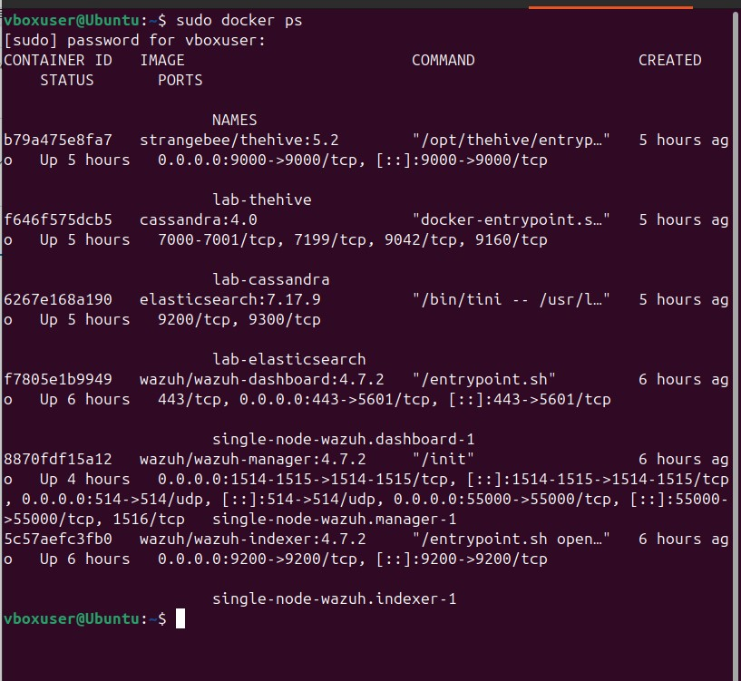
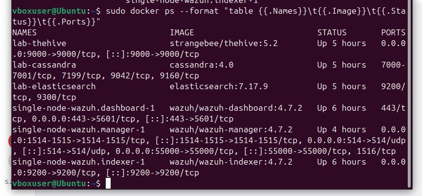
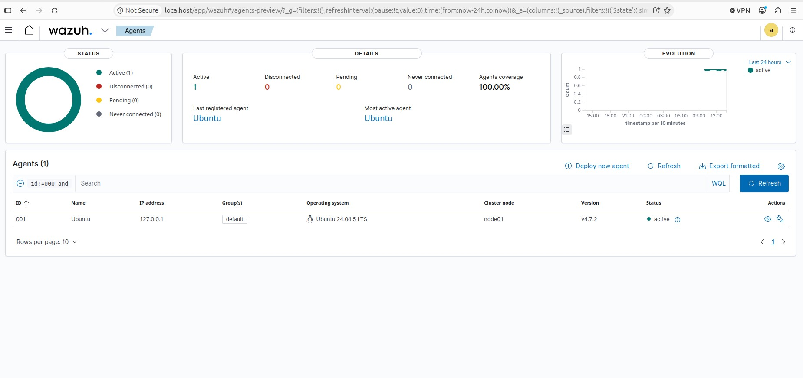

## ⚙️ Mise en place de l'intégration

**1. Installer `thehive4py` dans le Python de Wazuh**, et non dans celui de la VM :

```bash
sudo docker exec single-node-wazuh.manager-1 \
  /var/ossec/framework/python/bin/python3 -m pip show thehive4py
```

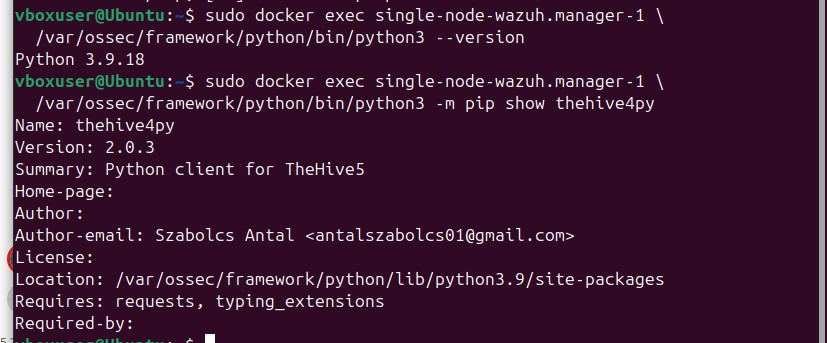

**2. Copier les scripts d'intégration** fournis (`custom-w2thive` et `custom-w2thive.py`) dans `/var/ossec/integrations/`, avec le propriétaire `root:wazuh` et les droits `750`.

**3. Déclarer l'intégration** dans `ossec.conf` (voir [`config/ossec-integration.xml`](config/ossec-integration.xml)) :

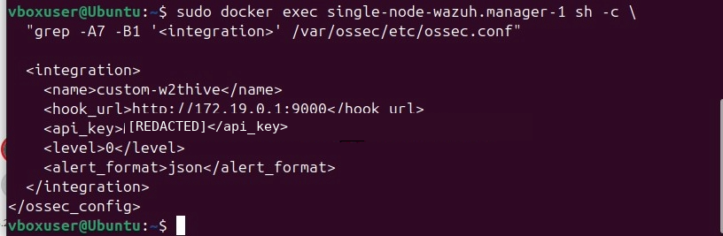

**4. Tester avec une alerte factice** :

```bash
sudo docker exec single-node-wazuh.manager-1 \
  /var/ossec/framework/python/bin/python3 \
  /var/ossec/integrations/custom-w2thive.py /tmp/test-alert.json '<API_KEY>' 'http://172.19.0.1:9000'
```

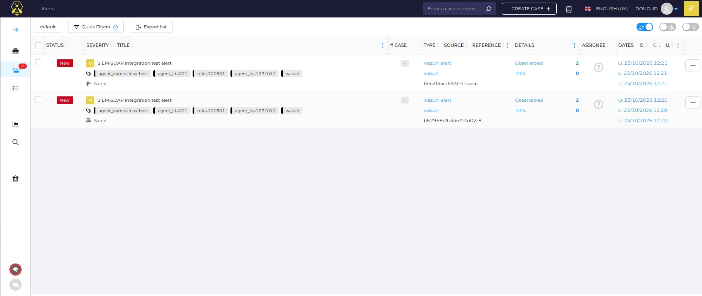
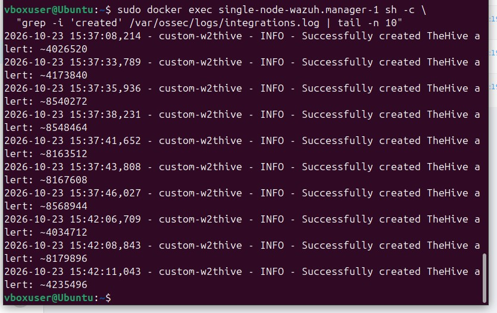

## 🔴 Scénario d'attaque : force brute SSH

**Logs système :** des échecs d'authentification SSH sont enregistrés dans `/var/log/auth.log`.

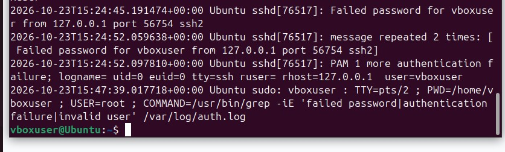

**Détection Wazuh :**

| Champ | Valeur |
|---|---|
| Règle | **5760** — sshd: authentication failed |
| Niveau | 5 |
| Source | 127.0.0.1 |
| Log | /var/log/auth.log |
| MITRE ATT&CK | **T1110.001** Password Guessing · **T1021.004** SSH |

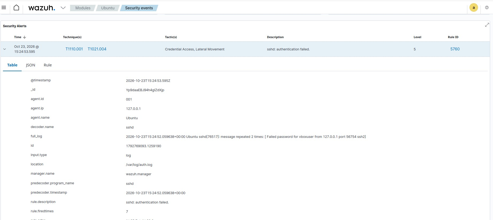

**Alerte transmise à TheHive**, avec ses tags (`rule=5760`, `agent_name`, `agent_ip`…), l'IP source extraite comme **observable**, et 13 alertes similaires regroupées :

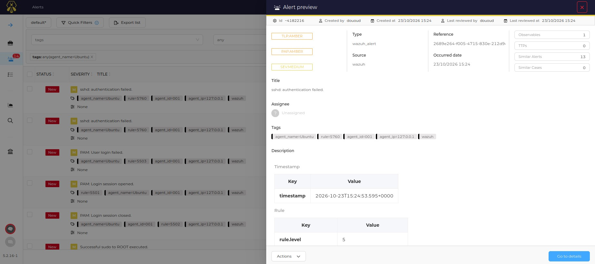

## 🔍 Analyse et constats

- **Pas de corrélation « brute force » :** 5 échecs ont généré 5 alertes individuelles (règle 5760). La règle de corrélation **5763** (niveau 10) ne se déclenche qu'à partir de **8 échecs depuis la même IP en 120 secondes**.
- **Bruit d'alertes :** avec `<level>0</level>`, **toutes** les alertes Wazuh sont envoyées à TheHive, y compris les événements bénins (sessions PAM, `sudo`).

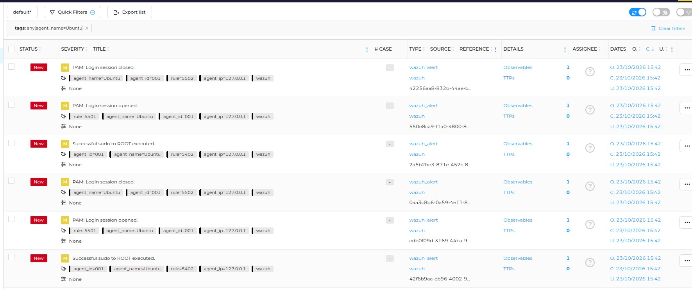

- **Pourquoi le Python de Wazuh ?** Le Manager exécute les intégrations avec son propre interpréteur, à l'intérieur du conteneur. Une bibliothèque installée sur la VM n'y est pas visible.
- **Pourquoi la passerelle varie ?** Docker attribue un sous-réseau à chaque réseau Compose selon ceux déjà existants. Ici, TheHive a pris `172.18.0.0/16`, donc le réseau Wazuh a obtenu `172.19.0.0/16`.

## 🚀 Pistes d'amélioration

- Relever le niveau d'intégration (ex. `<level>7</level>`) pour **réduire le bruit** et ne transmettre que les alertes pertinentes.
- Rejouer l'attaque avec **8 échecs ou plus en 2 minutes** pour déclencher la corrélation 5763.
- Ajouter **Cortex** pour enrichir automatiquement les observables (réputation d'IP, etc.).
- Ajouter une **réponse active** Wazuh (blocage automatique de l'IP attaquante).

## 📚 Compétences mobilisées

`SIEM` · `SOAR` · `Wazuh` · `TheHive` · `Docker` · `Analyse de logs` · `Détection d'intrusion` · `MITRE ATT&CK` · `Triage d'alertes` · `Intégration par API`
