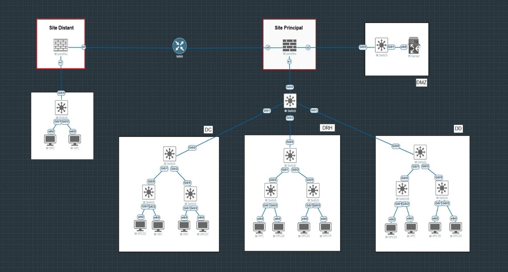

# Architecture réseau d'entreprise sécurisée — Cisco 3 niveaux + pfSense

> Projet réalisé pendant mon stage de fin d'études (2025-2026) : conception et mise en place, dans **EVE-NG**, d'un réseau d'entreprise multi-sites segmenté, filtré par **pfSense**, avec **DMZ** et **VPN site-à-site OpenVPN**.

   

*L'entreprise d'accueil est anonymisée. Toutes les adresses IP sont celles de l'environnement de simulation.*

---

## 🎯 Objectifs

- Segmenter le réseau par **direction métier** (un VLAN par direction).
- Centraliser le **routage inter-VLAN, le DHCP et le filtrage** dans un pare-feu pfSense.
- Isoler un **serveur exposé** dans une DMZ dédiée.
- Relier un **site distant** au site principal par un **tunnel VPN chiffré**.
- Valider l'**isolation** entre directions par des tests.

## 🗺️ Topologie

| Niveau | Équipement(s) | Rôle |
|---|---|---|
| Pare-feu | pfSense principal | Routage inter-VLAN (*router-on-a-stick*), DHCP, VPN, filtrage, DMZ |
| Cœur (Core) | 1 switch | Transport trunk 802.1Q uniquement |
| Distribution | 3 switches (DC, DRH, DD) | Création des VLANs, agrégation des accès |
| Accès | 6 switches (2 par direction) | Connexion des postes |
| DMZ | 1 switch + 1 serveur | Zone isolée pour les services exposés |
| Site distant | pfSense distant + 1 switch | VLAN 50 local, client VPN |

## 🔢 Plan d'adressage

| Zone | VLAN | Réseau | Passerelle | DHCP |
|---|---|---|---|---|
| DC — Direction opérationnelle | 20 | 172.16.20.0/24 | .254 | .100 – .200 |
| DRH — Ressources humaines | 30 | 172.16.30.0/24 | .254 | .100 – .200 |
| DD — Digitalisation (DSI) | 40 | 172.16.40.0/24 | .254 | .100 – .200 |
| Site distant | 50 | 172.16.50.0/24 | .254 (pfSense distant) | .100 – .200 |
| DMZ | 60 | 172.16.60.0/24 | .254 | Statique (serveur .10) |
| Management | 99 | 172.16.99.0/24 | .254 | .100 – .200 |
| Tunnel VPN | — | 10.10.10.0/30 | .1 serveur / .2 client | — |

## ⚙️ Configuration

### Switches Cisco
Les configurations complètes sont dans [`configs/cisco/`](configs/cisco/) :
- [`core-switch.txt`](configs/cisco/core-switch.txt) — trunks vers pfSense et les 3 distributions, ports inutilisés désactivés
- [`distrib-dc.txt`](configs/cisco/distrib-dc.txt) — modèle des 3 switches de distribution
- [`acc-dc1.txt`](configs/cisco/acc-dc1.txt) — modèle des 6 switches d'accès (PortFast sur les ports utilisateurs)
- [`switch-distant.txt`](configs/cisco/switch-distant.txt) — site distant

**Choix trunk / access :**
- **pfSense → Core** et **Core → Distributions** : *trunk* 802.1Q, chaque lien n'autorise que les VLANs nécessaires (`allowed vlan`).
- **Distribution → Accès** et **Accès → postes** : *access*, chaque switch d'accès ne porte qu'un seul VLAN.

### pfSense principal
- **em0** : WAN · **em1** : trunk vers le Core avec sous-interfaces `em1.20 / .30 / .40 / .99` · **em2** : DMZ (interface physique dédiée)
- **DHCP** par VLAN (Services → DHCP Server)
- **OpenVPN** en mode peer-to-peer, UDP 1194, tunnel `10.10.10.0/30`, chiffrement **AES-256-CBC + SHA256**

## 🛡️ Politique de sécurité

Tout le filtrage est **centralisé dans pfSense** (aucune ACL Cisco). Les règles sont évaluées de haut en bas, la première correspondance l'emporte, et les règles BLOCK sont placées avant les PASS.

| Interface source | Destination | Action | Raison |
|---|---|---|---|
| WAN (depuis le pfSense distant) | WAN, UDP 1194 | ✅ PASS | Tunnel OpenVPN entrant |
| WAN | tout | ⛔ BLOCK | Bloquer Internet entrant (par défaut) |
| DD (DSI) | tout | ✅ PASS | La DSI administre l'infrastructure |
| DC | DRH, DD, site distant | ⛔ BLOCK | Isolation des directions |
| DC | DMZ, Internet | ✅ PASS | Accès aux services et à Internet |
| DRH | DC, DD | ⛔ BLOCK | Isolation des directions |
| DRH | Site distant, DMZ, Internet | ✅ PASS | Accès autorisés |
| OpenVPN (site distant) | 172.16.0.0/16 | ⛔ BLOCK | Le site distant n'accède pas aux ressources du site principal |
| DMZ | 172.16.0.0/16 | ⛔ BLOCK | Le serveur exposé ne peut pas initier de connexion vers le LAN |
| DMZ | Internet | ✅ PASS | Mises à jour du serveur |

## ✅ Tests et validation

| Test | Commande | Résultat attendu | Résultat |
|---|---|---|---|
| DHCP VLAN 20 / 30 / 40 / 50 | `dhcp` (VPC) | IP dans .100 – .200 | ✅ |
| Passerelle depuis un poste | `ping 172.16.20.254` | Réponse | ✅ |
| Tunnel VPN | Status → OpenVPN | *up* | ✅ |
| Inter-sites via VPN | `ping 172.16.50.254` | Réponse via le tunnel | ✅ |
| **Isolation DC → DRH** | `ping 172.16.30.254` depuis VLAN 20 | **Timeout** (règle BLOCK) | ✅ |
| **DMZ → LAN** | `ping 172.16.20.254` depuis le serveur | **Timeout** (règle BLOCK) | ✅ |
| Trunks et VLANs | `show interfaces trunk`, `show vlan brief` | VLANs attendus actifs | ✅ |

## 🧩 Justification des choix

| Décision | Choix retenu | Pourquoi |
|---|---|---|
| Topologie | Hiérarchique 3 niveaux | Séparation des rôles, évolutivité, dépannage simplifié |
| Routage inter-VLAN | pfSense (*router-on-a-stick*) | Tout le trafic inter-directions passe par le pare-feu |
| Filtrage | Règles pfSense | Stateful, centralisé, journalisé |
| DMZ | Interface physique dédiée | Isolation maximale du serveur exposé |
| VPN | OpenVPN UDP | UDP évite le problème TCP-in-TCP |
| Adressage | 172.16.0.0/16, une /24 par VLAN | Correspondance VLAN ↔ sous-réseau lisible |

## 🚀 Pistes d'amélioration

- Passer le VPN en **mode TLS avec certificats (PKI)** plutôt qu'en clé partagée, et utiliser **AES-256-GCM**.
- Porter le **VLAN 99 de management** jusqu'aux switches d'accès (trunk `20,99` entre distribution et accès) pour pouvoir les administrer à distance.
- Activer **SSH** (et désactiver Telnet) pour l'administration des switches.
- Ajouter des protections de niveau 2 : **port-security**, **BPDU Guard**, **DHCP snooping**.
- Envoyer les **logs pfSense vers un SIEM** (voir mon projet [Mini SOC Wazuh + TheHive](../mini-soc-wazuh-thehive)).

## 📚 Compétences mobilisées

`Segmentation VLAN` · `Trunk 802.1Q` · `Modèle hiérarchique Cisco` · `pfSense` · `Règles de pare-feu stateful` · `DMZ` · `VPN site-à-site` · `DHCP` · `Tests d'isolation réseau` · `EVE-NG`
